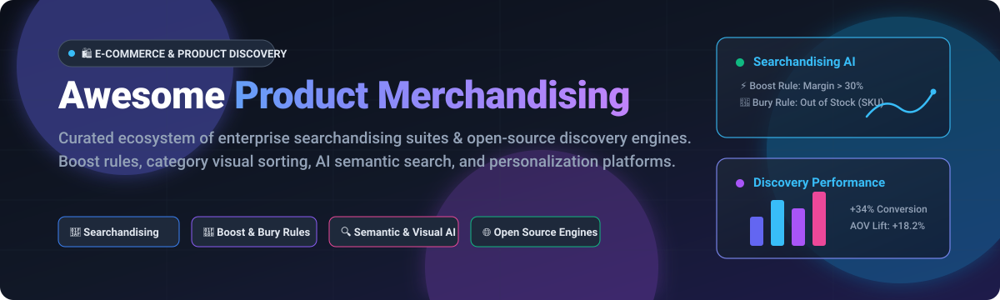

  

# 🛍️ Awesome Product Merchandising 

  
  
  
  
  
  

> 🛒 **A curated directory of top-tier SaaS solutions, searchandising platforms, visual sorting software, and open-source merchandising engines.**  
> Optimize e-commerce search, product discovery, category page sorting, boost-and-bury rules, and AI recommendations.

---

## 📑 Table of Contents

- [📊 Sector Overview & Market Dynamics](#-sector-overview--market-dynamics)
- [☁️ SaaS & Commercial Hosted Platforms](#️-saas--commercial-hosted-platforms)
- [💻 Open-Source GitHub Projects](#-open-source-github-projects)
- [🤝 How to Contribute](#-how-to-contribute)
- [💖 Support & Sponsorship](#-support--sponsorship)
- [🌟 Star History](#-star-history)
- [⚖️ Disclaimer & Governance](#️-disclaimer--governance)

---

## 📊 Sector Overview & Market Dynamics

The global e-commerce search and product discovery software market is valued at approximately **$6.0 billion** and is projected to surpass **$13.3 billion** over the next decade at a CAGR of **~9.2%**. The industry exhibits a distinct dual structure: **highly fragmented** at the SMB and point-solution app layer (where hundreds of turnkey search plugins and specialized apps compete across Shopify, BigCommerce, and WooCommerce), yet **moderately concentrated** at the mid-market and enterprise tier where high-contract leaders (such as Bloomreach, Algolia, and Constructor) capture major retail catalog searchandising workflows.

---

## ☁️ SaaS & Commercial Hosted Platforms

The table below lists leading commercial SaaS product merchandising and search platforms, **sorted descending by company size (valuation / estimated ARR / market capitalization)**:

| Platform 🏷️ | Valuation / Scale 📈 | Starting Pricing 💳 | Free Tier Limits / Trial Period ⏱️ | Key Features & Focus 🎯 |
| :--- | :--- | :--- | :--- | :--- |
| **[Shopify Combined Listings](https://help.shopify.com/en/manual/products/combined-listings)** | ~$213B - $224B Market Cap | **$2,300/mo** (Requires Shopify Plus subscription) | **3-day free trial** + $1/mo for first month (Standard Shopify trial; Plus requires demo) | Native multi-variant parent-child grouping on product pages; swatch navigation, custom SEO URLs per variant. |
| **[Algolia](https://www.algolia.com/)** | $2.3B Valuation (~$100M+ ARR) | **$0.50 per 1,000 search requests/mo** (Grow plan with pay-as-you-go overages) | **Free forever plan (Build tier):** 10,000 search requests/mo, 50,000 records, 5,000 recommend requests, 1 GB storage cap. | Developer-first AI search API, instant search widgets, custom ranking rules, visual facets, and typo-tolerant search. |
| **[Bloomreach](https://www.bloomreach.com/)** | $2.2B Valuation ($260M+ ARR) | **$5,000/mo** (~$60,000/yr starting baseline for Discovery package) | **No free tier; guided interactive demo available** (Proof of Concept arranged during enterprise sales evaluation). | Enterprise search, visual category merchandising, conversational AI (Loomi), 1:1 personalization, and marketing CDP integration. |
| **[Constructor.io](https://constructor.io/)** | $550M Valuation (~$10M - $50M ARR) | **~$16,666/mo** (~$200,000/yr enterprise threshold based on procurement benchmarks) | **No free tier; zero-dollar Proof Schedule** (Revenue opportunity analysis & PoC for qualified enterprise prospects). | Revenue-optimizing searchandising algorithms, multi-context campaigns, dynamic facet grouping, and automated category curation. |
| **[Nosto](https://www.nosto.com/)** | ~$33M Total Funding (~$15M - $30M ARR) | **~$500/mo** (Base fee scaling with store gross merchandise value and monthly traffic) | **Free to install on app stores; no self-serve free plan** (14-day assisted merchant Proof of Concept upon qualification). | Commerce Experience Platform (CXP), semantic site search, category visual merchandising, dynamic bundles, and A/B testing. |
| **[Searchspring](https://searchspring.com/)** (Athos Commerce) | ~$15M - $25M ARR | **$599/mo** (Core starting tier scaling by catalog SKU count and monthly search sessions) | **No self-serve free plan; 14-day custom sandbox / guided demo** provided post-sales consultation. | Visual merchandising grid editor, scheduled boost & bury campaigns, automated out-of-stock deprioritization, and search analytics. |
| **[Klevu](https://athoscommerce.com/klevu-search-platform/)** (Athos Commerce) | ~$15M - $20M ARR (~$18M Funding) | **$199/mo** (Entry Smart Search tier; $699+/mo for integrated Category Merchandising) | **14-day free trial** (Full feature access across Smart Search and Visual Merchandising modules). | NLP keyword search, visual PIN/boost controls, automated synonym suggestions, predictive autocomplete, and recommendations. |
| **[Attraqt](https://www.attraqt.com/)** (Crownpeak) | ~$10M - $15M Historical ARR (Acquired) | **~$2,500/mo** (~$30,000/yr enterprise implementation tier) | **No free tier; demo environment available on request** through Crownpeak sales engineers. | Omnichannel product discovery, Fredhopper algorithmic merchandising, AI ranking controls, and curated category landing pages. |
| **[Syte](https://www.syte.ai/)** | ~$71M Total Funding (Private) | **~$1,250/mo** (~$15,000/yr modular tier scaling with catalog size and camera search volume) | **No free plan; bespoke sandbox trial** available during enterprise discovery engagements. | Visual AI search, camera-based visual discovery, automated visual product tagging, and hyper-personalized visual recommendation carousels. |
| **[Fast Simon](https://www.fastsimon.com/)** | Fast-growing private SaaS | **$39.99/mo** (Starter tier for up to 2,000 sessions/mo; scales up to $99-$499+/mo for Growth tiers) | **Free forever plan:** up to 100 sessions/mo (Includes basic AI search and filters; 14-day free trial on paid tiers). | Visual merchandising, smart predictive search, dynamic filters, automated collection curation, and cross-sell/upsell widgets. |

---

## 💻 Open-Source GitHub Projects

The list below features open-source search engines, vector databases, and dedicated searchandising engines suitable for building self-hosted product merchandising workflows. **Sorted descending by GitHub stargazers count**:

| Open-Source Project 🛠️ | GitHub_Stars 🌟 | Primary Tech / Language 💻 | Description & Merchandising Capabilities 🔍 |
| :--- | :--- | :--- | :--- |
| **[Meilisearch](https://github.com/meilisearch/meilisearch)** |  | Rust | Ultra-fast, typo-tolerant search engine featuring custom ranking rules (boost/bury attributes), exact-match priorities, faceted search, and hybrid vector search. |
| **[Qdrant](https://github.com/qdrant/qdrant)** |  | Rust | High-performance vector database offering payload-based filtering, ideal for semantic product discovery, similarity matching, and multimodal recommendation engines. |
| **[Typesense](https://github.com/typesense/typesense)** |  | C++ | Blazing-fast, developer-friendly Algolia alternative with built-in curation rules (pinning, boosting, hiding products), synonym management, dynamic faceting, and vector search. |
| **[OpenSearch](https://github.com/opensearch-project/OpenSearch)** |  | Java | Community-driven distributed search and analytics suite offering neural search, query reranking plugins, lexical/BM25 scoring, and enterprise catalog scale. |
| **[Quickwit](https://github.com/quickwit-oss/quickwit)** |  | Rust | Cloud-native search engine designed for sub-second search directly on cloud storage (Amazon S3); ideal for massive, high-volume e-commerce catalogs. |
| **[Vespa](https://github.com/vespa-engine/vespa)** |  | C++ / Java | Advanced big-data search & machine-learned ranking platform supporting real-time ML inference, hybrid vector search, and deep personalization for large catalogs. |
| **[Marqo](https://github.com/marqo-ai/marqo)** |  | Python | End-to-end multimodal vector search engine providing automated embeddings, CLIP-powered visual search, and automated merchandising relevancy out of the box. |
| **[Smile-SA ElasticSuite](https://github.com/Smile-SA/elasticsuite)** |  | PHP / Elasticsearch | The most complete platform-native searchandising engine for Magento 2 / Adobe Commerce; features visual category sorting, virtual categories, rule-based boost & bury, and facet controls. |
| **[Elastic-Suite Gally](https://github.com/Elastic-Suite/gally)** |  | PHP / Symfony | Modern API-first, MACH-ready searchandising platform decoupling merchandising rule management from ecommerce frontends with GraphQL API support. |
| **[PragmaSearch](https://github.com/wemaxie/PragmaSearch)** |  | TypeScript / Node.js | Local-first, self-hosted semantic search engine designed as a zero-cost Algolia alternative with Reciprocal Rank Fusion, BM25 + embeddings, and pin/boost ranking rules. |

---

## 🤝 How to Contribute

Contributions are warmly welcomed! To add or update an entry:

1. 🍴 **Fork** this repository.
2. 🌿 **Create a branch** for your update (`git checkout -b feature/add-merchandising-tool`).
3. 📝 **Edit `README.md`** following the standard tabular format:
   - Include company scale/revenue, exact starting tier prices, explicit free limits/trial duration, and verified links.
   - For open-source tools, include the official repository link, tech stack, and official GitHub Stars_Badge.
4. 🚀 **Submit a Pull Request** with a brief summary of why the tool is suitable for product merchandising.

---

## 💖 Support & Sponsorship

Thank you for visiting and using **Awesome Product Merchandising**! If this curated repository helped you discover searchandising engines, compare ecommerce platforms, or implement category optimization in your business:

- ⭐ **Star this repository** on GitHub to keep it visible and help others find it!
- 🍴 **Fork and share** it with your fellow merchandisers, developers, and ecommerce peers.
- ☕ **Buy me a coffee / Sponsor**: If you'd like to support ongoing curation, research, and maintenance, please consider sponsoring via the [GitHub Sponsor Dashboard](https://github.com/sponsors/ishandutta2007). Your support is deeply appreciated!

---

##  Star History

---

## ⚖️ Disclaimer & Governance

- ℹ️ This repository is a **community-curated index** intended for informational and educational purposes. Inclusion does not constitute an endorsement.
- 🔐 E-commerce merchandising engines process shopper clickstreams, catalog attributes, and customer interaction data; ensure all implementations adhere to applicable privacy standards (GDPR, CCPA) and security best practices.
- 📜 Always verify software license terms prior to enterprise production deployment (e.g., GPL-3.0, Apache-2.0, MIT, or commercial SaaS agreements).

---

  Built with ❤️ for e-commerce merchandisers, search engineers, catalog specialists, and product discovery teams.

